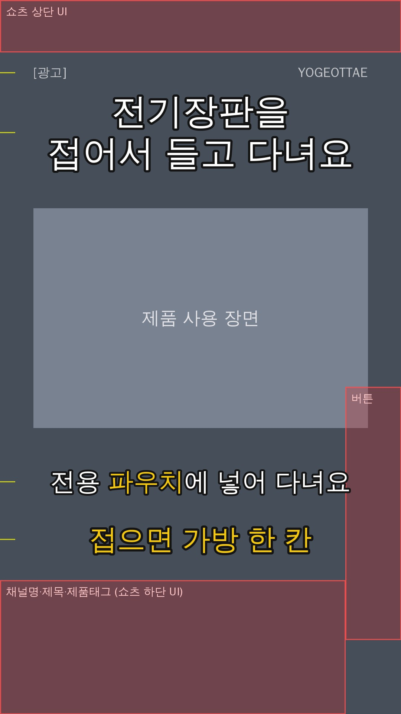

# 요거어때(YOGEOTTAE) 쇼핑쇼츠 제작 기준

쿠팡파트너스 기반 쇼핑쇼츠 채널의 공통 기준이다. 모든 제품 작업은 이 문서와 `templates/channel_defaults.json`을 따른다.
기존 `shopping-shorts` 스킬과 다른 부분이 있으면 **이 문서가 우선**이다. 달라진 점은 맨 아래 표에 정리했다.

- 핵심 타깃: 30~40대 여성
- 레이아웃 미리보기: `docs/layout_preview.jpg` (대체 폰트로 그린 근사치. 코트라 볼드로는 글자 폭이 조금 다를 수 있다)
- 제품별 작업 양식: `templates/product_brief.md`

---

## 1. 상품 입력과 분석

**입력**: 쿠팡 상품 링크 + 상품 캡처 이미지. 필요하면 상품명과 가격을 따로 적는다.

**분석 항목** (`templates/product_brief.md` 1번에 채운다)
1. 제품명, 가격(캡처한 날짜와 함께), 주요 기능과 특징
2. 구매자가 얻는 실질적인 장점
3. 일상에서 해결되는 불편함
4. 구매를 이끌 핵심 매력 3가지
5. 30~40대 여성의 관심 포인트
6. 경쟁 상품과의 차이
7. 영상에서 가장 먼저 보여줄 장면

**사실 확인 규칙**
- 상품 페이지나 캡처에서 확인한 내용만 쓴다. 확인한 내용에는 출처(캡처 날짜)를 남긴다.
- 확인하지 않은 성능, 판매량, 후기, 할인율은 만들지 않는다.
- 가격과 할인율은 자주 바뀐다. 대본과 화면 문구에는 넣지 않는다.
- "후기 톤 연출"(예: "옆 텐트 분이 꺼내 줬어요")은 **쓰지 않는다.** 실제 겪은 일처럼 들리면 지어낸 후기가 된다.

## 2. 추천 상품 10개 발굴

**우선 카테고리**: 주방(조리도구·수납·설거지), 살림(청소·정리·생활 편의), 욕실(물때·정리·위생), 세탁(빨래 정리·건조·옷 관리), 공간 활용(틈새 수납·좁은 집), 계절(겨울 보온·여름 냉방), 육아·가족, 선물용 가성비 생활용품.

**선정 기준**: 최근 판매·구매 반응, 실제 후기와 평점, 영상으로 기능 설명이 쉬운지, 사용 전후 차이가 분명한지, 충동구매를 부를 만큼 실용적인지, 가격 대비 만족도, 반복 제작에 맞는지.

**출력 표** (매번 10개)

| # | 상품명 | 가격(확인일) | 추천 이유 | 타깃 고객 | 후킹 문구 | 구매 링크 | 확인 수준 |
|---|---|---|---|---|---|---|---|

- `확인 수준`에는 실제로 본 것만 적는다. 예: "상품 페이지 확인(리뷰 수 ○개, 평점 ○)", "검색 결과만 확인".
- 판매량이나 순위를 직접 확인하지 못했으면 "판매 검증 완료", "베스트셀러" 같은 표현을 쓰지 않는다.
- 구매 링크는 쿠팡 상품 URL로 적는다. 파트너스 단축 링크(`link.coupang.com/a/...`)는 채널 운영자의 파트너스 계정에서 직접 만들어야 한다.

## 3. 영상 규격

| 항목 | 값 |
|---|---|
| 플랫폼 | 유튜브 쇼츠 |
| 비율·해상도 | 9:16, 1080×1920 |
| 길이 | 20~35초 (불필요하게 늘리지 않는다) |
| 형식·프레임 | MP4, 30fps |
| 스타일 | 빠른 전개, 자연스러운 제품 리뷰 |
| 도입 | 1~2초 안에 후킹 |
| 마무리 | 자연스럽게 구매 관심 유도 |

장면 하나는 2.5~3초. 원본 컷 전환이 섞이지 않게 한다(기존 스킬 6장 규칙 유지).

## 4. 화면 배치 (1080×1920)

| 요소 | 색 | 폰트 | 크기(추정) | 위치 중심(px) | CapCut 위치 x / y |
|---|---|---|---|---|---|
| 워터마크 `YOGEOTTAE` | #FFFFFF, 불투명도 68% | 코트라 볼드 | 약 36px | 우상단, 오른쪽 끝 990 · y195 | 0.667 / 0.797 |
| `[광고]` 표시 | #FFFFFF, 불투명도 68% | 코트라 볼드 | 약 34px | 좌상단, 왼쪽 끝 90 · y195 | −0.759 / 0.797 |
| 상단 후킹 문구 | #FFFFFF + 검정 외곽선·그림자 | 코트라 볼드 | 약 96px, 2줄, 한 줄 9자 이내 | x540 · y356 | 0 / 0.63 |
| 음성 자막 | #FFFFFF, 강조 단어 #F4C70F, 검정 외곽선 | 코트라 볼드 | **CapCut 15** (약 68px) | x540 · y1295 | 0 / −0.349 |
| 하단 강조 문구 | #F4C70F + 검정 외곽선 | 코트라 볼드 | 약 76px, 1줄, 10자 이내 | x540 · y1450 | 0 / −0.51 |

**피해야 할 구역** (쇼츠 UI, 기기마다 조금씩 다름)
- 위 0~140px: 검색·메뉴 아이콘
- 오른쪽 x 930 이상, y 1040~1720: 좋아요·댓글·공유 버튼
- 아래 1560px 이상: 채널명, 제목, 제품 태그

**배치 규칙**
- 글자는 가로 90~930px 안에 둔다. 하단 쪽 문구는 오른쪽 버튼 때문에 폭 760px 이내로 쓴다.
- 상단 문구, 음성 자막, 하단 강조 문구는 서로 겹치지 않는다. 위 표의 세로 위치를 바꿀 때는 세 요소의 간격을 함께 확인한다.
- 자막은 1~2줄, 한 줄 11자 이내. 음성과 타이밍을 맞추고 오탈자·띄어쓰기를 검수한다.
- **자막 크기 15 확인**: 68px 추정치는 기존 썸네일 배치값(크기 27·scale 0.805)에서 거꾸로 계산한 값이다. 첫 영상을 빌드한 뒤 휴대폰 화면에서 작아 보이면 16~18로 올린다.
- 워터마크는 처음부터 끝까지 같은 위치·크기·투명도로 둔다. 제품 중요한 부분이 우상단에 오는 컷은 영상을 아래로 조금 내리거나 다른 컷을 쓴다.
- `[광고]`를 남긴 이유: 쿠팡파트너스 수수료를 받는 영상이라 경제적 이해관계를 밝혀야 한다. 유튜브 업로드 때 "유료 프로모션 포함"도 체크하고, 고정댓글에 파트너스 안내 문구("이 포스팅은 쿠팡 파트너스 활동의 일환으로, 이에 따른 일정액의 수수료를 제공받습니다.")를 함께 단다.

## 5. CapCut 편집 설정

- 폰트: 코트라 볼드체(KOTRA BOLD). CapCut에서 아무 텍스트에 한 번 적용해 저장하면, 그 프로젝트의 `draft_content.json` → `fonts[]`에서 resource_id를 읽어 `channel_defaults.json`의 `font.capcut_resource_id`에 넣는다. 그다음부터 스크립트가 자동으로 지정할 수 있다.
- 자막 크기 15, 위치 하단 안전 영역(위 표), 흰색, 강조 단어 #F4C70F, 외곽선 검정(#141414).
- 원본 영상 소리는 끈다. 배경음악은 목소리보다 약 20dB 낮게 두고, 말할 때 더 줄인다(덕킹).

## 6. 썸네일

**두 가지를 따로 만든다**

| 구분 | 무엇 | 쓰는 곳 |
|---|---|---|
| A. 영상 첫 프레임 | 영상 맨 앞 1프레임에 썸네일 디자인(배경 컷 + 문구)을 넣는다 | 업로드할 때 유튜브 앱의 "커버 선택"에서 이 프레임을 고른다. 첫 장면 자체로도 시선을 끈다 |
| B. 별도 이미지 파일 | `thumbnail_1080x1920.jpg` | 앱에서 사진 업로드로 커버를 지정할 수 있으면 쓴다. 커뮤니티 글, 다른 플랫폼 재업로드에도 쓴다 |

유튜브가 쇼츠 커버를 고르는 방식은 앱 버전에 따라 바뀐다. 업로드 화면에서 사진 업로드 메뉴가 없으면 A 방식으로 지정한다.

**장면 고르기** (후보 최소 3개를 비교하고 고른 이유를 한 줄 남긴다)
1. 기능이 가장 잘 보이는 장면
2. 사용 전후 차이가 분명한 장면
3. 실제로 쓰는 장면
4. 궁금증이 생기는 장면
5. 제품이 크고 선명하게 보이는 장면

- 단순 정면 제품 사진보다 실제 사용 장면을 먼저 고른다.
- 문구가 들어갈 위쪽 22~30%에는 제품이나 손이 없어야 한다.
- 현재 고른 장면이 마음에 들지 않는다고 하면 반드시 다른 장면으로 바꾼다.

**문구**: 6~12자, 2줄 이내. 1줄 #FFFFFF, 강조(2줄 또는 핵심 단어) #F4C70F, 코트라 볼드. "최저가", "역대급" 같은 과한 광고 문구는 쓰지 않는다.

## 7. 대본

설명 나열이 아니라 **불편함 → 변화** 중심으로 쓴다.

| 구간 | 내용 | 예시 |
|---|---|---|
| 0~3초 | 후킹 | "이거 아직도 모르세요?", "왜 이제 알았을까요?" |
| 3~8초 | 불편함 공감 | 평소 살림에서 겪는 불편 한두 문장 |
| 8~23초 | 핵심 기능 2~3가지 | 사용 장면을 보여주며 장점 설명 |
| 23~30초 | 결과 + 관심 유도 | "작은 변화인데 살림이 편해져요." + 링크 위치 안내 |

- 링크 안내 문구는 실제로 링크를 올린 위치에 맞춘다. 기본값: "제품 정보는 고정댓글에서 확인해 보세요."
- 의성어·의태어(쏙, 착착, 스르륵 등)는 Kanna가 어색하게 읽어서 쓰지 않는다.
- "지금 안 사면 품절", "이거 모르면 손해" 같은 압박 문구는 쓰지 않는다.
- 숫자는 읽는 대로 적어도 된다(예: 백십 볼트).

## 8. AI 음성

- ElevenLabs Kanna(`5I7B1di44aCL15NkP0jn`), `eleven_multilingual_v2`, 속도 1.19 + `post_tempo` 1.06
- 밝고 친근한 톤, 홈쇼핑식 과장 없음. stability 0.52 / similarity 0.57 / style 0.10
- 문장 사이 무음은 자동으로 줄인다(`tools/elevenlabs_tts.py`, `trim_silence=True`)
- 음성은 약 −14 LUFS, 배경음악은 목소리보다 약 20dB 낮게

API 키는 `tools/.env`(git에 올라가지 않음) 또는 환경변수 `ELEVENLABS_API_KEY`에 둔다.

## 9. 영상 소스

**우선순위**
1. 판매자·브랜드가 사용을 허락한 제품 영상 (허락받은 메시지·날짜를 `products/<제품>/sources.md`에 남긴다)
2. 직접 찍은 사용 영상
3. 상업적 사용이 허용된 스톡 영상 (라이선스 링크를 남긴다)
4. 사용 권한을 확인한 추가 이미지·영상

**하지 않는 것**: 다른 사람의 유튜브·틱톡·인스타그램·샤오홍슈 영상을 내려받거나 그대로 다시 쓰지 않는다.

원본이 부족하면 `templates/product_brief.md` 6번 양식으로 필요한 장면 목록과 촬영 가이드를 쓴다.

**판매자에게 영상 사용을 요청할 때 보낼 문구 예시**
> 안녕하세요, 유튜브 쇼핑쇼츠 채널 '요거어때'입니다. 판매 중이신 ○○ 상품을 쇼츠로 소개하고 싶은데, 상세페이지의 제품 영상과 이미지를 편집해 사용해도 될까요? 영상에는 [광고] 표시와 쿠팡파트너스 안내를 함께 넣습니다.

---

## 기존 스킬과 달라진 점

| 항목 | 기존 `shopping-shorts` 스킬 | 요거어때 기준 (우선) |
|---|---|---|
| 원본영상 | 유튜브·틱톡·샤오홍슈에서 yt-dlp로 직접 다운로드 | **다운로드 금지.** 판매자 허락·직접 촬영·상업용 스톡만 |
| 대본 | 15초, 후기 톤 연출 허용, CTA "댓글에 '○○'" | 20~35초, **지어낸 후기 금지**, CTA는 링크 위치 안내 |
| 자막 | 화면 중앙, 2단어 버스트, 서울한강체 B | 하단 안전 영역, 1~2줄, 코트라 볼드 15, 강조 #F4C70F |
| 상단·하단 문구 | 없음 | 상단 흰색 후킹 / 하단 #F4C70F 장점 문구 |
| 워터마크 | `nanatem_shop` 하단 중앙, 투명도 0.22 | `YOGEOTTAE` 우상단, 불투명도 약 68% |
| `[광고]` | 우상단 | 좌상단으로 이동(워터마크와 겹치지 않게) |
| 썸네일 폰트·색 | 카페24 단정해, 2줄 #bbffb4 | 코트라 볼드, 강조 #F4C70F, 6~12자, 후보 3개 이상 비교 |

`build_shorts.py`가 아직 위 값을 읽지 못하면 스크립트 상수를 이 표에 맞게 바꿔야 한다. 이 저장소에는 `build_shorts.py`가 없어서 수정하지 못했다.
